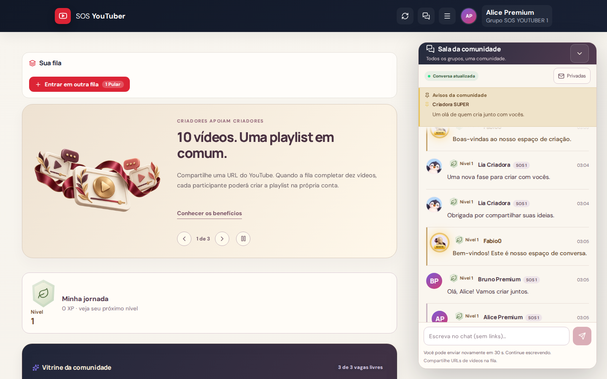
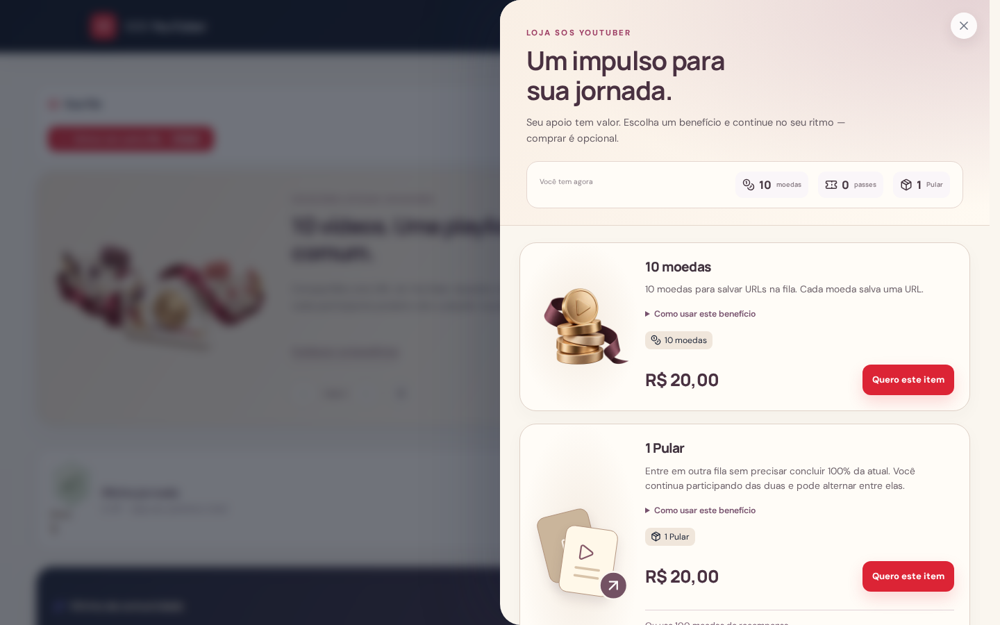

# Auditoria de produto e revisão visual — 13/10/2026

## Alcance e conclusão
Revisão direta do código e de fluxos reais no Chromium, com capturas desktop/mobile e contas sintéticas. Houve acesso autenticado à produção como Fábio e entrada no participante na rodada anterior; artefatos privados ficam ignorados. Não é certificação de 100% dos estados possíveis. Configuração real definitiva Meta/Evolution, entrega WhatsApp, pagamento real e publicação coordenada permanecem fora da comprovação atual.

A base integrada tem mais recursos do que a interface deixava perceber. As lacunas principais eram ligações entre identidades e canais, visibilidade de inventário/SUPER, apresentação da loja e falta de prova visual. Código/teste verde não substitui inspeção de imagens.

## Achados corrigidos e evidências
| Etapa | Achado | Correção / prova |
|---|---|---|
| 1. Login e Owner | Tipografia miúda, formulário apagava entrada rejeitada | Texto curto, contraste, fontes locais, preservar campos ao falhar; login real previamente confirmado |
| 2. Integrações | Bot e integração salvavam modos diferentes; Híbrido+ não aparecia | Preferência compartilhada e recuperação do legado por data; Meta + Evolution visíveis; não afirmar execução de catálogo ainda não ligado |
| 3. Avatar e identidade | Avatar Owner não chegava ao participante/chat; Root aparecia USER | Catálogo Owner, espelhamento bidirecional, reconciliação no início da API, papel atual no chat |
| 4. Sala pública | Faixa fechada não atendia à experiência desejada | Regra de Fábio: iniciar aberta, fixa; área desktop reservada, controle de recolher voluntário; privadas separadas |
| 5. Conversas e presentes | Backend disponível sem uma experiência participante completa | Caixa de mensagens, inventário, SUPER, destinatário fixo, transferência idempotente; prova entre Alice/Bruno sintéticos |
| 6. Loja | Modal comum, sem identidade, artes inadequadas ao catálogo | Loja lateral, cards configuráveis, benefícios/preço/CTA separados da arte; moedas, Pular, SUPER sem mudar catálogo aprovado |
| 7. Banners e carregamento | Artes genéricas, carregamento padrão | Duas ilustrações editoriais novas, banners só no participante, tela acolhedora e tentativa de reconexão |
| 8. Operação Owner | Aviso difícil de antecipar, dados exigiam atualizar manualmente | Prévia do texto antes do envio, atualização periódica da comunicação, estado real persistido |

## Direção de experiência
- Participante: começar sabendo sua fila e encontrando a comunidade; sala global sempre reconhecível como pública. Privadas, recados e presentes em um espaço próprio. Avatar consistente em cada superfície.
- Owner: entender o efeito de uma alteração e ver confirmação de persistência. Separar credencial configurada, integração validada e entrega confirmada. Não confundir flags preparadas com automação operacional.
- Identidade visual: creme, navy, vinho/plum e dourado moderado. Fontes Manrope/DM Sans locais, títulos legíveis e poucas ideias por bloco.
- Movimento: feedback breve em botões, entrada suave de mensagens, loja lateral e ilustração de carregamento. Respeitar prefers-reduced-motion, sem espera artificial na abertura real.
- Imagens não contêm preço, quantidade nem benefício comercial; textos e valores continuam vindo do catálogo administrável.

## O que eu acrescentaria depois de convergir esta entrega
1. Histórico de itens com origem e destinatário, aproveitando item_grants; reduz dúvidas sobre compras e presentes.
2. Busca de participante por nome/telefone nos controles que ainda expõem IDs; evita ações na conta errada.
3. Visão consolidada de ocorrências para Owner: pagamento aguardando conciliação, mensagem não entregue e acesso pendente, com próximo passo.
4. Atualizações incrementais do chat: hoje snapshots limitados a 60 mensagens a cada 5 s reconciliam identidade/moderação; imagens personalizadas podem aumentar tráfego. Evoluir somente com medida concreta de volume.
5. Testes assistivos com leitor de tela e teclado em todos os fluxos críticos; não declarar conformidade integral só por screenshots.

6. Separar o carregamento de telas administrativas do bundle inicial; o build atual sinaliza chunk JS ~644 kB (182 kB gzip). Medir impacto antes de refatorar.

## Artes desta rodada
- assets/user/community-editorial-v3.webp: composição editorial de cartões de vídeo, fita vinho, porcelana creme, medalhão dourado e elementos de conversa; banner da comunidade e carregamento.
- assets/user/messages-editorial-v3.webp: balões de conversa e presente em porcelana, fita vinho/dourado; banner de mensagens, espaço privado e estado vazio do chat.
- Criadas com imagegen integrado, transparência real; comprimidas para WebP com alpha. Sem substituir as fontes editáveis de ícones nem escrever texto comercial na arte.
- Prompt 1: editorial sculptural still-life, three ivory video cards, champagne play medallion, burgundy satin connection, plum/coral chat bubbles, transparent padded composition, no text/currency/gaming.
- Prompt 2: ivory/plum porcelain chat bubbles and cream gift with burgundy satin ribbon, tiny play detail, soft studio light, transparent padding, no text/prices/gaming.

## Validação final confirmada
- Gate avatar-final-* encerrado: 249/249 testes da API, 21/21 do cliente, lint/TypeScript, build e 5/5 cenários Playwright GREEN.
- git diff --check sem erros. Revisão de 110 caminhos alterados/novos não encontrou telefone pessoal, chave privada nem os padrões de token procurados. Capturas autenticadas reais e sessão de navegador permanecem ignoradas em .local-tmp.
- Chromium real, contas sintéticas, viewport desktop 1440 e mobile 390. Verificada comunicação entre contas, transferência única do presente, entrada/seleção de fila com Pular, persistência de Híbrido+, avatar decodificado e geometria sem sobreposição.
- A inspeção com os olhos confirmou o avatar corrigido em ambos os tamanhos, loja sem corte da arte, mensagens privadas com rolagem própria e sala pública aberta/fixa. No mobile, conteúdo principal e chat têm regiões de rolagem separadas.
- O build ainda sinaliza bundle inicial de 644 kB (~182 kB gzip): aviso de desempenho registrado, sem falha de compilação.
- Não foram comprovados nesta rodada: todas as combinações de estados, navegadores adicionais, leitores de tela, entrega por APIs definitivas Meta/Evolution, pagamento real ou atenção humana aos vídeos.

## Capturas aceitas do gate final
Imagens de contas sintéticas, atualizadas em 13/10/2026. Os testes percorrem os fluxos; a revisão visual avalia também recortes, contraste, textos e densidade.

| Passo | Desktop | Mobile |
|---|---|---|
| 1. Acesso | [Login](evidencias/login-desktop.png) | [Login](evidencias/login-mobile.png) |
| 2. Híbrido+ salvo | [Meta + Evolution](evidencias/premium-hybrid-1440.png) | [Meta + Evolution](evidencias/premium-hybrid-390.png) |
| 3. Comunidade e avatar Owner | [Sala aberta](evidencias/premium-participant-1440.png) | [Sala aberta](evidencias/premium-participant-390.png) |
| 4. Loja lateral | [Produtos](evidencias/premium-store-1440.png) | [Produtos](evidencias/premium-store-390.png) |
| 5. SUPER | [Benefícios](evidencias/premium-store-super-1440.png) | [Benefícios](evidencias/premium-store-super-390.png) |
| 6. DM, inventário e presente | [Conversas](evidencias/premium-messages-1440.png) | [Conversas](evidencias/premium-messages-390.png) |
| 7. Comunicação Owner | [Prévia e controles](evidencias/convergencia-comunicacao-1440.png) | [Prévia e controles](evidencias/convergencia-comunicacao-390.png) |
| 8. Carregamento e banner | [Carregamento](evidencias/community-loading-1440.png) | [Banner de mensagens](evidencias/banner-mensagens-mobile.png) |

## Publicação
Base main b684f236 confirmada após fetch. Rodada atual em astra/convergencia-20261012, pronta para commits temáticos e PR em rascunho; consultar o checkpoint de publicação abaixo quando disponível. Railway API/Web anteriores online e /data presente. Patch d1be5c2e-d014-4ee2-bfab-9f295ea61286 continua STAGED; accept-deploy retornou cancelamento por aprovação ausente apesar da autorização do usuário. Não contornar por outro canal. Frontend novo depende de backend novo; coordenar publicação, sem liberar Web isoladamente.

### Achado adicional na inspeção final
Imagem de catálogo era bloqueada pelo CORP same-origin entre API e Web. Corrigido apenas em /avatars/:slug, com prova de bytes WEBP/cabeçalho e decodificação real no navegador. Este achado confirma por que elemento no DOM não bastava.

## Checkpoint Git desta entrega
- PR em rascunho: https://github.com/Fabiomtt2/sosyt/pull/3
- Código e capturas verificados: a07ca66896ed8578cbb319bbe19b4b7ae9e035f7; documentação consolidada em commit posterior na mesma branch. Main permanece b684f236ebf50766b02aacabedc122c82c9111b1.
- Commits temáticos:
- 4ae7d6b73589df6122983a25232afe68001f0344 chore: bundle local fonts and stabilize verification resources
- b0de8630e09697f65805fa39570df933b8cd61d9 fix(whatsapp): converge persisted hybrid provider preferences
- 88b2e38c4023f8d674eabf929201bc2601f62a33 fix(community): unify owner identity and secure cross-user transactions
- dce37430455c5e736e382fe5e258af267997b648 feat(web): integrate community room and illustrated participant experience
- a07ca66896ed8578cbb319bbe19b4b7ae9e035f7 test: verify community interactions and fresh responsive visuals
- Nenhum deploy novo confirmado. O PR permanece em rascunho pelo bloqueio de publicação coordenada, não por falha no gate local.
